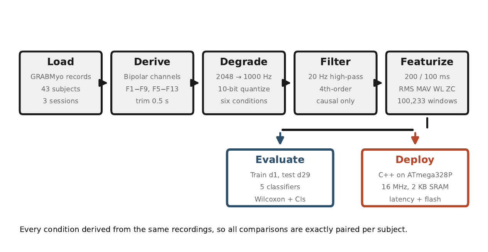
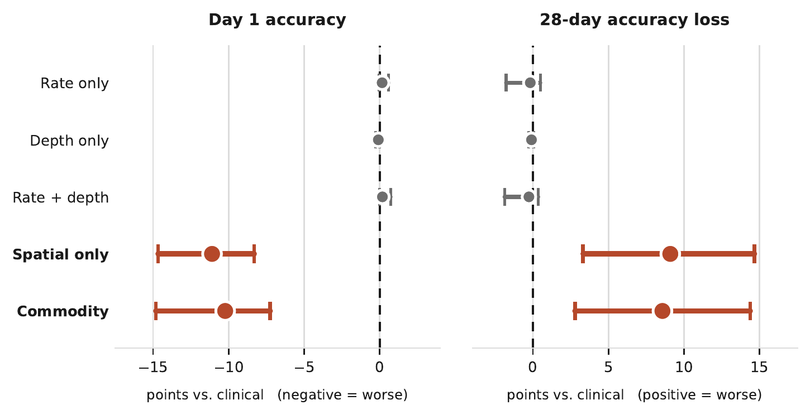

# EMG Gesture Classifier: Hardware Constraints and Cross-Session Degradation

Code for the paper *Do Hardware Constraints Compound Cross-Session Degradation?
A Controlled Ablation of Channel Count, Sample Rate, and Quantization in Surface
EMG Gesture Classification* (A. Hossain and J. Lin, submitted to *Biomedical
Signal Processing and Control*).

The study takes the open GRABMyo surface-EMG dataset (43 subjects, sessions on
days 1, 8 and 29) and degrades an 8-channel, 2048 Hz, floating-point baseline
along three hardware axes: channel count, sample rate and bit depth. That gives
six exactly paired conditions. Classifiers are trained on Day 1 and tested
unchanged on Days 8 and 29. An ATmega328P (Arduino Uno) implementation is
profiled for memory and timing and checked for numerical equivalence with the
offline analysis.



## Main result



With Random Forest, reducing the sampling rate to 1000 Hz or quantizing to
10 bits changed Day-1 accuracy by less than 0.75 points and 28-day degradation
by less than 2 points. The fixed two-channel layout used throughout the paper
(derivations 0 and 4) cost 11.1 points of Day-1 accuracy and added 9.1 points
of degradation. A post-hoc sweep shows that the size of this two-channel
penalty depends strongly on which two channels are kept. Points are paired
per-subject differences from the 8-channel baseline (n = 43) with 95% BCa
confidence intervals.

The code release cited by the paper is tagged
[`v1.0`](https://github.com/lainx06/emg-gesture-classifier/tree/v1.0).
A full-data reproduction run is in `results/reproduction/`.

## Repository layout

```
src/                     Analysis pipeline (Python)
  download_grabmyo.py    Fetches the GRABMyo recordings this study uses
  preprocess.py          WFDB loading, bipolar derivation, edge trimming
  pipeline.py            Degradation chain and feature extraction
  calibrate_vmax.py      Quantizer full-scale (V_max) calibration
  build_cache.py         Feature caches for all six conditions
  separability.py        Five-model evaluation and statistics
  lda_contrasts.py       Four LDA hardware/session contrasts
  quant_saturation_audit.py  Quantizer saturation rates per session
  vmax_sensitivity.py    Effect of a training-only quantizer calibration
  channel_correlation.py Correlations supporting the bipolar derivation
  ablation.py            Random Forest degradation-axis comparison
  stats_check.py         Bootstrap confidence intervals
  spatial_sweep.py       Exploratory channel-budget and placement sweep
  audit_spatial_sweep.py Independent audit of the sweep
  shap_explainer.py      SHAP attribution migration and profile shift
  confusion_matrices.py, plot_cm.py, fig_*.py   Figures
  deployability.py       Flash/SRAM footprint estimates per model
  validate_streaming.py  Checks the streaming sub-block feature combiner
  export_playback.py, run_playback.py           Python-to-AVR equivalence check
  arduino/
    deployability_profile/   Timing and memory profiling sketch
    playback_verify/         Verified streaming firmware (replayed ADC codes)
notes/                   Analysis plan, design decisions, logged results
results/spatial_sweep/   Sweep outputs (CSV) and audit log
paper/                   Manuscript source (LaTeX) and submitted figures
docs/                    Images used in this README
```

`PROJECT_CONTEXT.md` explains the design decisions. Several choices look odd
from the code alone but are deliberate; read it before changing the pipeline.

## Getting started

1. Use Python 3.14 and install the pinned environment:

   ```
   pip install -r requirements_analysis_frozen.txt
   ```

   The exact versions used for the paper are in `software_versions.txt`.

2. Download the data. This study uses only gestures 11, 16 and 17, so you
   don't need the full 9.1 GB dataset:

   ```
   python src/download_grabmyo.py
   ```

   This fetches those recordings from GRABMyo version 1.1.0 on PhysioNet
   (https://doi.org/10.13026/89dm-f662) into `data/grabmyo/`, checks every
   file against PhysioNet's checksums, and can be re-run to resume. `data/` is
   excluded from git.

3. Build the feature caches, then run the analyses:

   ```
   python src/build_cache.py
   python src/calibrate_vmax.py        # quantizer thresholds (optional check)
   python src/separability.py
   python src/lda_contrasts.py
   python src/ablation.py
   python src/stats_check.py
   python src/spatial_sweep.py
   python src/shap_explainer.py
   python src/channel_correlation.py
   python src/quant_saturation_audit.py
   python src/vmax_sensitivity.py      # optional: training-only calibration
   ```

   The caches are written to `cache/`, which is excluded from git. Random
   seeds are fixed at 42. `vmax_sensitivity.py` recalibrates the quantizer on
   the training trials alone, rebuilds the quantized features and reports the
   change in accuracy and drop.

4. Embedded verification needs an Arduino Uno and `pip install pyserial`.
   The order matters, because the firmware compiles its own copy of the
   generated header:

   1. `python src/validate_streaming.py`, which must print PASS.
   2. `python src/export_playback.py`, which must end with `EXPORT COMPLETE`.
      It writes `playback/playback_params.h` and one `codes_<trial>.bin` per
      test trial.
   3. Copy `playback/playback_params.h` over
      `src/arduino/playback_verify/playback_params.h`.
   4. Flash `src/arduino/playback_verify/playback_verify.ino`.
   5. `python src/run_playback.py --port COM3 --all`, using your board's port.
      It streams all 18 test trials and must report 666 windows and
      `B->C VERIFIED`.
   6. `python src/run_playback.py --port COM3 --trial s1g11t6 --mode filter`.
      Summary mode does not return filtered samples, so this one-trial run is
      what checks the filter-output criterion (within 0.5 ADC LSB). It must
      also report `B->C VERIFIED`.

5. The manuscript source is in `paper/`, with the submitted figures in
   `paper/figures/`. Regenerated figures are written to `figures/`.

## Data

GRABMyo is published on PhysioNet under CC BY 4.0 by Jiang, Pradhan and He.
Please cite the dataset and its paper:

- N. Jiang, A. Pradhan, J. He. Gesture Recognition and Biometrics
  ElectroMyogram (GRABMyo), version 1.1.0. PhysioNet, 2024.
  https://doi.org/10.13026/89dm-f662
- A. Pradhan, J. He, N. Jiang. Multi-day dataset of forearm and wrist
  electromyogram for hand gesture recognition and biometrics. *Scientific
  Data* 9, 733 (2022). https://doi.org/10.1038/s41597-022-01836-y

No data are redistributed in this repository.

## Citation

If you use this code, please cite it with the "Cite this repository" button
on GitHub (from `CITATION.cff`). A citation for the paper will be added on
publication.

## Disclaimer

Approved for Public Release; Distribution Unlimited: AFRL/PA Case No.
AFRL-2026-4323. The views expressed are those of the authors and do not
necessarily reflect the official policy or position of the Department of the
Air Force, the Department of Defense, or the U.S. Government.

## License

See `LICENSE`.
